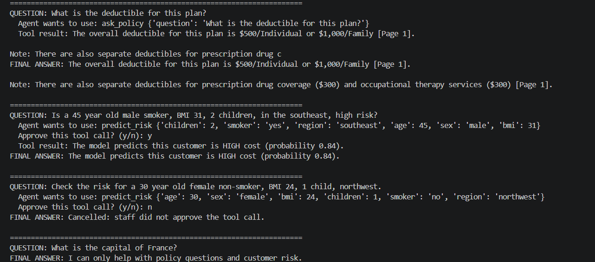
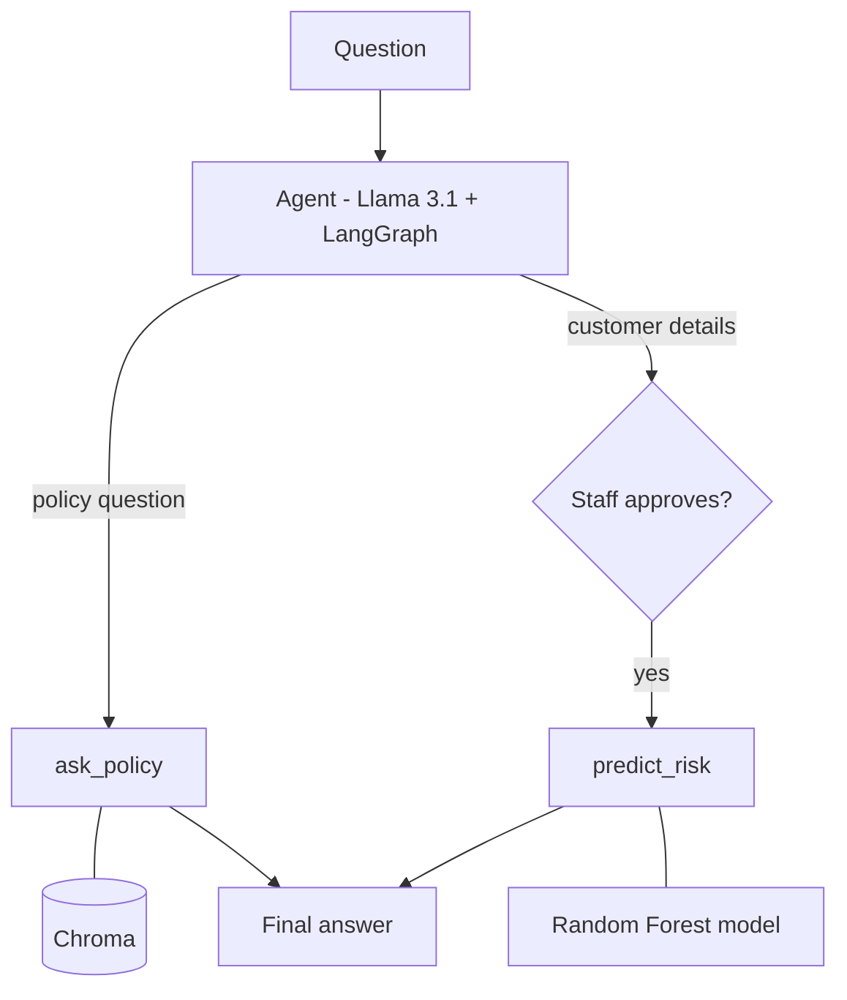

# ClaimWise

AI assistant for health insurance staff. Ask a question in plain English and the agent decides whether to search the policy or run a risk model.

**Python · LangChain · LangGraph · RAG · Ollama · Chroma · scikit-learn · FastAPI**



## Highlights

- Answers policy questions from a PDF with page citations. Scored 10 out of 10 on the evaluation set.
- Returns "I don't know" when the policy doesn't cover the question. Off-topic questions are stopped before they reach the LLM.
- Predicts high-cost customers with a Random Forest model (0.98 precision on test data), also served through a FastAPI endpoint.
- Staff must approve before the agent runs a risk prediction.
- Runs locally with Ollama, so no data is sent to an outside API.

## How it works



The agent has two tools. `ask_policy` embeds the question, pulls the 3 closest chunks of the policy PDF from Chroma, and has the model answer only from those chunks, with the page number. `predict_risk` validates the customer details and runs the trained model.

## Results

| Check | Result |
|---|---|
| Risk model (test data) | 0.92 accuracy, 0.98 precision, 0.70 recall |
| Baseline (always "not high cost") | 0.75 accuracy, 0 recall |
| RAG evaluation | 10 of 10 correct, each with a page citation |
| pytest | 6 of 6 passing |

## Problems I ran into

**An answer with correct numbers that was still wrong.** For a specialist visit, the model wrote "$50 copay and 40% coinsurance," as if you pay both. The $50 is in-network and the 40% is out-of-network. I added a prompt rule to keep them separate and reran every test question.

**The agent ignored a prompt rule.** It sometimes called the same tool two or three times for a simple question, then gave the wrong answer, even after the prompt said to call a tool once. I fixed it in code: after one tool call, the model has no tools and can only write the answer.

**The best search result wasn't always first.** For the ER question, the right chunk came back second. That's why it retrieves 3 chunks instead of 1.

## Running it

You need Python 3.12 and [Ollama](https://ollama.com).

```
ollama pull llama3.1:8b
ollama pull nomic-embed-text

git clone https://github.com/arpit-kaur/claimwise.git
cd claimwise
python -m venv .venv
.venv\Scripts\activate
pip install -r requirements.txt

python train.py
python vector_store.py
python agent.py
```

API: `uvicorn api:app --reload`, then open http://127.0.0.1:8000/docs
Tests: `pytest -v`
Evaluation: `python eval_rag.py`

## Data

- `data/insurance.csv`: the public Medical Cost Personal dataset
- `data/policy.pdf`: a Summary of Benefits and Coverage document published by CMS for a fictional plan

## Next steps

A larger evaluation set, a web page for staff and support for multiple policy documents.